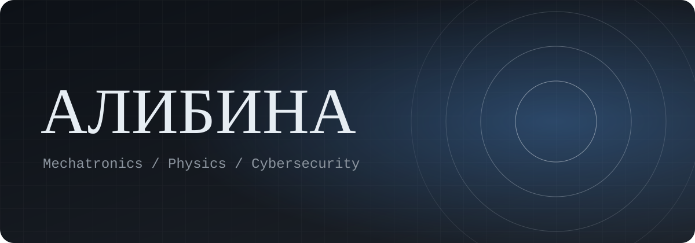
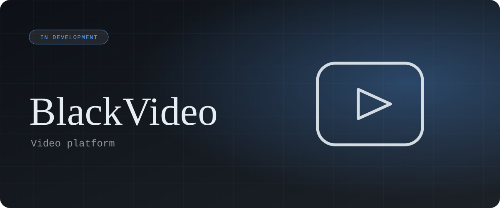
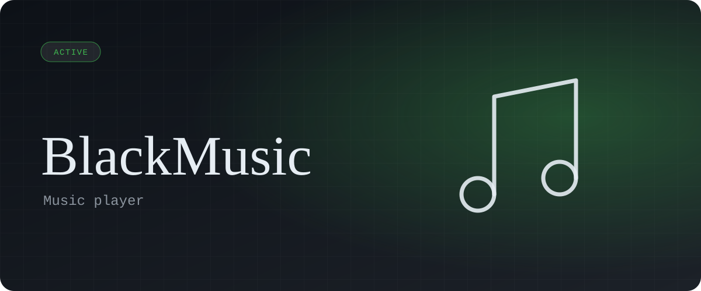
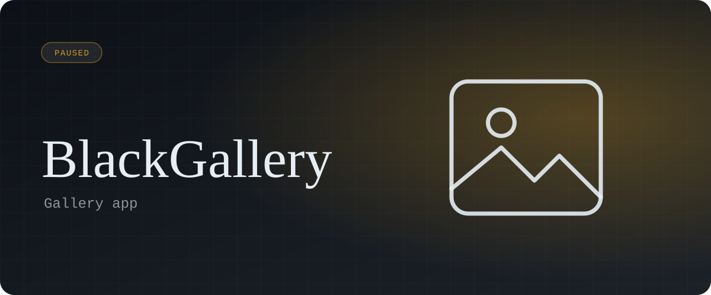
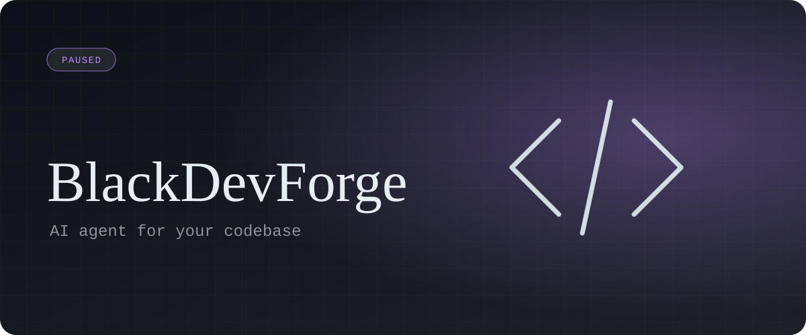
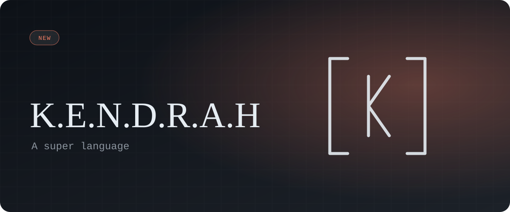
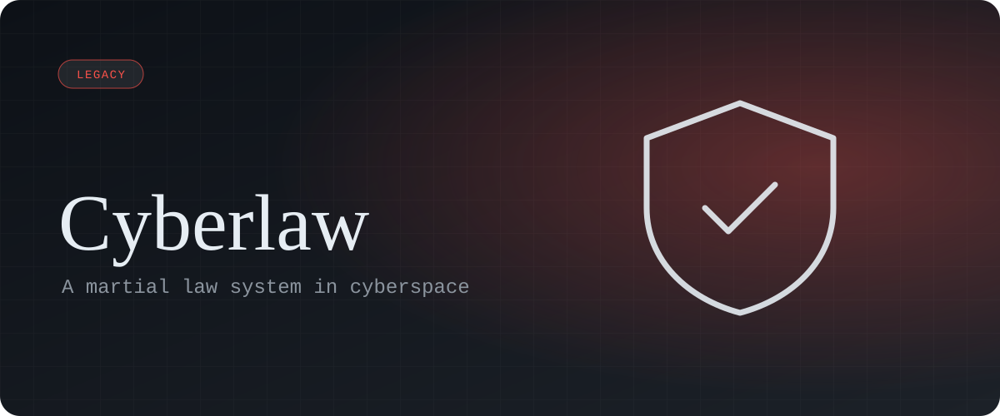
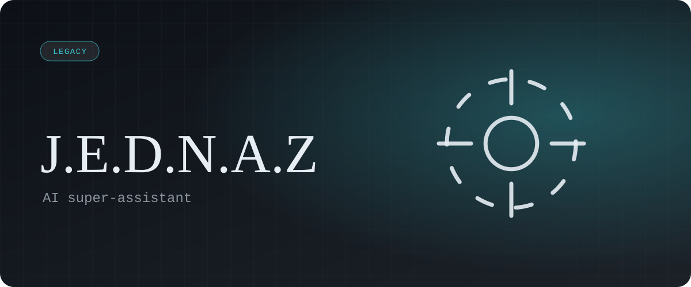
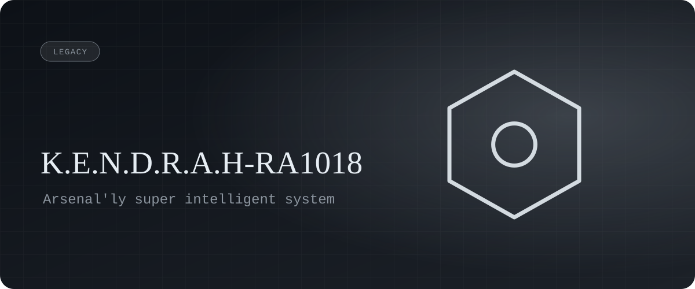

<!--
  LoneStamp/LoneStamp · profile README
  Layout: newsletter-style. Hero, short intro, then one block per item:
          title (with icon) → themed banner → short description → link.
  Assets: assets/banners/*.svg and assets/icons/*.svg (commit the assets folder with this file).
  Theme:  dark / onedark on every card. Keep any new widget on the same theme.
  Notes:  GitHub strips inline style="" and target="". HTML comments are public in the raw file.
-->

# Hi, I'm АЛИБИНА

> My 9-year-old account was suspended.

Currently building **[BlackVideo](https://github.com/BlackBlazent/BlackVideo)**, a video platform.
<!-- TODO: add one concrete detail. What does BlackVideo do that other players and platforms don't? -->

Excited about bringing advanced capabilities, like AI-driven integrations and **OSINT** tooling, into everyday software.

&nbsp;

## Now

| | |
| :-- | :-- |
| **Building** | [BlackVideo](https://github.com/BlackBlazent/BlackVideo), in development |
| **Active** | BlackMusic |
| **Learning** | [Ada](https://learn.adacore.com/) |
| **Exploring** | AI-driven integrations, OSINT tooling |
| **Studying** | B.S. in Cybersecurity (Cloud Security), Adyghe State University |
| **Into** | Mechatronics Engineering, Physics, Cybersecurity |

&nbsp;

## Organizations

My projects are built under organizations, not under my personal name.

| | Organization | About |
| :-: | :-- | :-- |
|  | [**BlackBlazent**](https://github.com/BlackBlazent) | Home of the current projects. |
|  | [**Black Corp: Intelligence (BCI)**](https://github.com/BCICDIS) | Home of the proprietary and legacy projects. |
|  | [**CCC**](https://github.com/CCC-Network) | A church network. |

&nbsp;

## Projects

**Current** · published under [BlackBlazent](https://github.com/BlackBlazent)

###  BlackVideo

A video platform, currently in development.
<!-- TODO: one concrete sentence about what makes it different -->

[View on GitHub →](https://github.com/BlackBlazent/BlackVideo)

###  BlackMusic

A music player focused on playback quality and a large catalog. Active.

[View on GitHub →](https://github.com/BlackBlazent/BlackMusic)
<!-- TODO: add the repository link when ready -->

###  BlackGallery

*Amalgamated Luminous Library Expo Recreation Yearnability.* A gallery app. Paused.

###  BlackDevForge

A cross-platform AI agent meant to live inside your app, intended to understand your codebase, find bugs, and suggest UI improvements. Paused.

###  K.E.N.D.R.A.H

A super language.

[View on GitHub →](https://github.com/BCICDIS/kendrah.git)
<!-- TODO: confirm the status, the owning organization, and add a repository link -->

&nbsp;

**Proprietary and legacy** · under [Black Corp: Intelligence](https://github.com/BCICDIS)

###  Cyberlaw

A martial law system in cyberspace.

###  J.E.D.N.A.Z

AI super-assistant by Jednaz Lonestamp, a digital clone merging intelligence, identity, and innovation.

###  K.E.N.D.R.A.H-RA1018

Arsenal'ly super intelligent system.

&nbsp;

## Toolkit

**Languages**

**Frameworks and tools**

&nbsp;
<!--
## On repeat

&nbsp;
-->

## System diagnostics
<!--

-->

Top languages reflects bytes of code on GitHub, not skill level.

&nbsp;

## Elsewhere

<!-- TODO: the Y Combinator link is the generic homepage. Replace it with a profile or company page, or remove it, so it does not imply an affiliation. -->

<!--
  Add social links ONLY when the real handle is known. Never publish "yourusername" placeholders.
  Template (same dark style as above):
  
  Previously planned: Facebook, VKontakte, Rossgram, Yappy, Instagram
-->

&nbsp;

Happy building,
**АЛИБИНА**

Last revised: October 2026